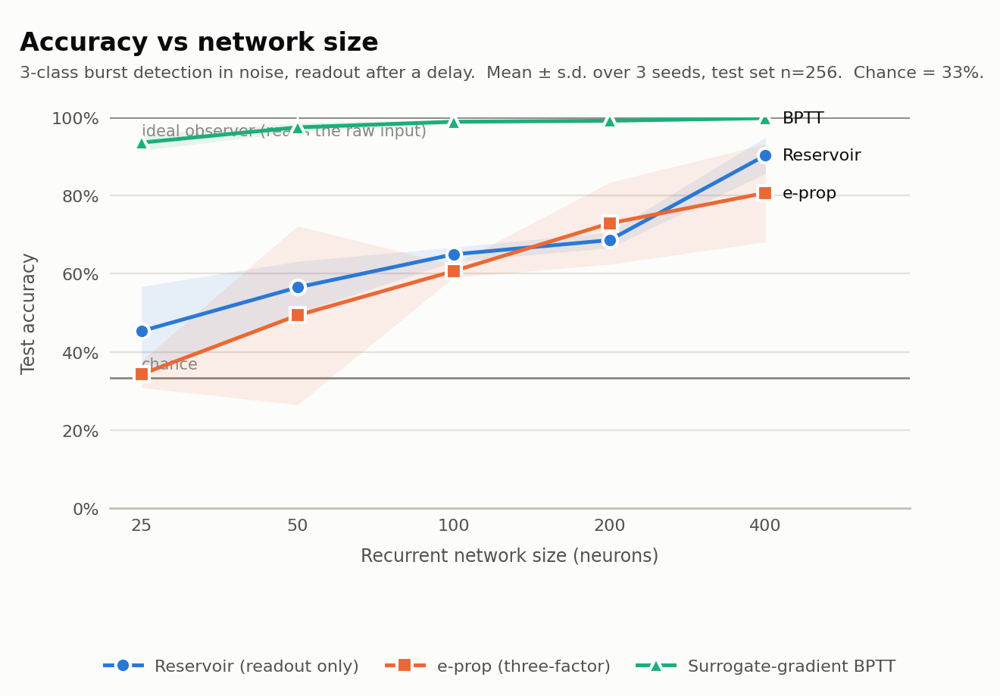
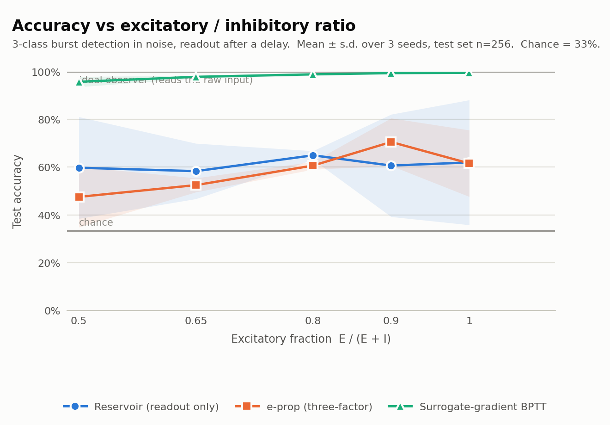
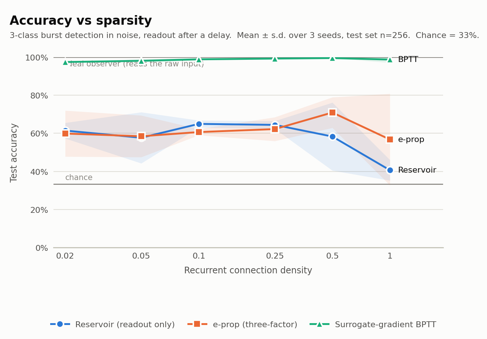
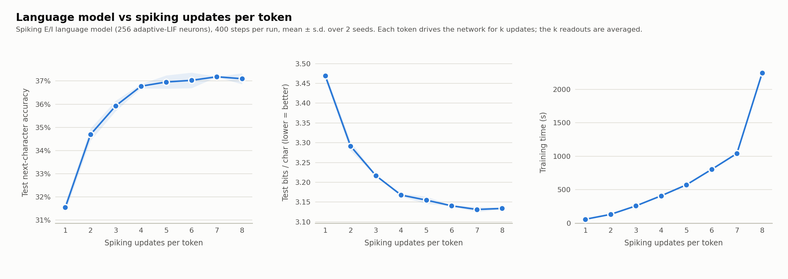
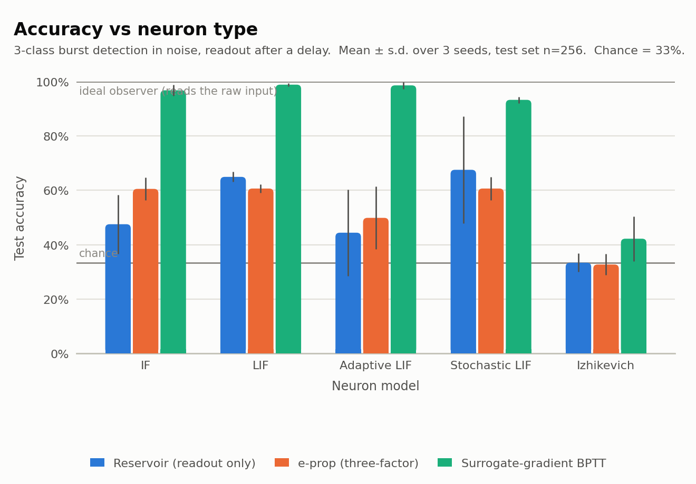
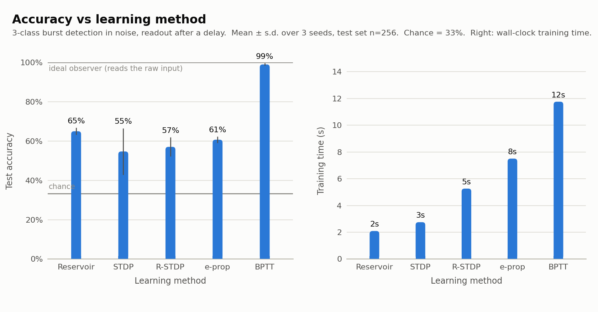
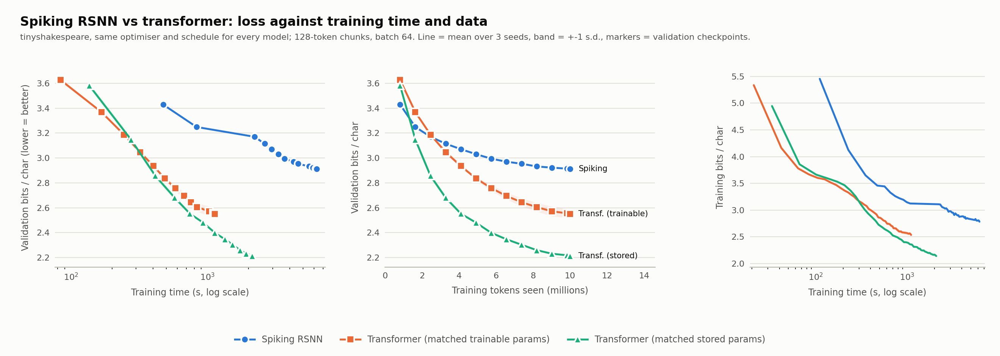
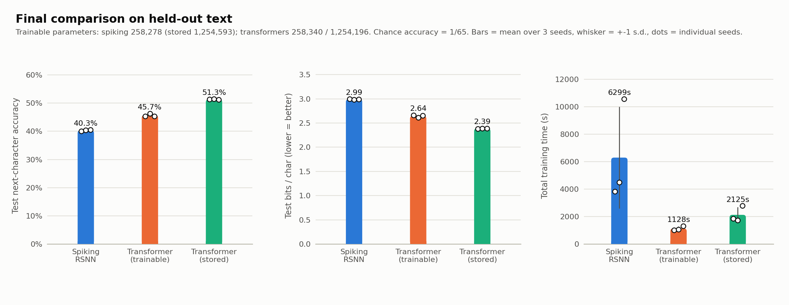

# biolearning

This project is intended as a quick experiment/demonstration of the training of Recurrent Spiking Neural Networks (RSNNs) as compared to Transformers.
It evaluates the performance of RSNNs on a time-series noise-rejecting classification task before training an RSNN on a character-level NLP task in comparison to two Transformers.

## Optimization tests

The RSNNs are evaluated with regards to specific changes:

1. Network size, ranging from 25-400 neurons
2. Excitation/Inhibition Ratio, from 0.5-1.00 E/(E+I)
3. Sparsity, from 0.02-1
4. Timesteps per token, from 1-8
5. Neuron Model (Integrate-and-Fire (IF), Leaky IF (LIF), Adaptive LIF (aLIF), Stochastic LIF (sLIF), Izhikevich)
6. Learning Method (Simple Reservoir Readout, Spike-Timing-Dependent Plasticity (STDP), Reward-Modulated STDP (R-STDP), Eligibility Propagation (e-Prop), Backpropagation Through Time (BPTT))

Before the tests, a search over learning rates was run for each learning method (and for each neuron model in the neuron test) to find good training values. The search used a validation set at one reference setting, so the rates were not tuned again at every point on a graph. Tests 1-3, 5 and 6 used the time-series classification task. Test 4 used the character-level NLP task described below. Each test was run 3 times, except test 4, which was run 2 times. Reported uncertainty is reflected in the graphs. Output values were percent accuracy, with an optimal value of 100%, and, for the NLP task, test bits per character, in which a lower score is better. Also recorded were the training times, in seconds, for any tests to which it is relevant.

### Results













## NLP Task

An RSNN was compared to two Transformer models: one contained an equivalent number of parameters as the RSNN model, while the other one contained the same amount of *effective* parameters as the RSNN (affected by sparsity). The RSNN used a fixed setup instead of the best result from each optimization test: 1024 adaptive LIF neurons, 80% excitatory, a sparsity of 0.05 (same scale as test 3), and 1 timestep per token. Each model was trained on a character-by-character level on the TinyShakespeare dataset. Training graphs recorded over 3 seeded runs were produced, as well as charts recording computation time per model.

### Results





## Conclusions

## Full Disclosure

This project was made in collaboration with Claude Sonnet 5.5. The initial concept for this project, as well as each individual test was an original idea. The contribution of the AI in this case was the actual execution of writing the code. Each experiment was run manually over the course of 2-3 hours on a Surface Pro, but these experiments would all be massively accelerated with GPU access. Aside from simple formatting, visual design, the usage guide, the reference list, and a few factual corrections, this writeup was typed entirely by hand without AI assistance. All AI-generated content was reviewed.

## Usage

### Requirements

Python 3.9 or newer and PyTorch 2.0 or newer (the Transformer uses `scaled_dot_product_attention`). Everything runs on a GPU automatically when one is available (`--device cpu` forces the CPU).

```bash
pip install torch numpy matplotlib
pip install datasets pandas   # optional: WikiText-2 (--data wikitext2) and the Colab notebook tables
```

### Repository layout

| Path | Contents |
|---|---|
| `neurons.py` | The neuron models (IF, LIF, aLIF, sLIF, Izhikevich, plus a Poisson input neuron) behind one common interface |
| `rsnn.py` | The `RSNN` class (excitatory/inhibitory populations, Dale's law, sparse connectivity) and the learning methods: `SurrogateBPTT`, `STDP`, `RSTDP`, `ThreeFactor` (e-prop), plus `InhibitorySTDP` and `HomeostaticScaling` |
| `tests.py` | The optimization tests (network size, E/I ratio, sparsity, timesteps per token, neuron model, learning method) |
| `biolearning_benchmarks.ipynb`, `build_colab_notebook.py` | The same tests as a Google Colab notebook, and the script that generates it from the source files |
| `model.py`, `train_model.py` | The spiking character-level language model and its training script |
| `transformer_model.py`, `compare_models.py` | The Transformer baseline and the RSNN-versus-Transformer comparison |
| `results/`, `results_compare/` | Output of `tests.py` and `compare_models.py` (the figures above) |

### Quick check

Each script has a `--quick` mode that runs a tiny version in a few minutes. Run these first to confirm everything works on your machine.

```bash
python neurons.py                # self-test of the neuron models
python rsnn.py                   # self-test of the network and the learning methods
python tests.py --quick
python compare_models.py --quick
```

### Optimization tests

```bash
python tests.py                          # all six sweeps, results in results/
python tests.py --only size ei           # a subset: size ei sparsity steps neuron method
python tests.py --seeds 5                # more seeds per point (the steps sweep has its own count, `lm_seeds` in tests.py)
python tests.py --plots-only             # redraw the figures from the saved results
```

Learning rates are tuned the first time they are needed and cached in `hparams.json` (`--retune` repeats the search). Results are saved after every sweep, so an interrupted run resumes where it stopped (`--force` repeats finished sweeps). Each sweep writes a figure (`fig_*.png`) and the table behind it (`fig_*.csv`); `results.json` holds the raw per-seed values. The `steps` sweep trains the language model on TinyShakespeare, which is downloaded into `data/` on first use, and is the slowest sweep.

### Google Colab

Upload `biolearning_benchmarks.ipynb` to [Google Colab](https://colab.research.google.com) (File, Upload notebook), choose Runtime, Change runtime type, GPU, and run the cells. `QUICK_RUN = True` in the settings cell gives a fast first pass; set it to `False` for the full benchmark. Figures and tables are shown in the notebook instead of being saved. The notebook embeds copies of the source files, so run `python build_colab_notebook.py` again after editing any of them.

### Training the language model

```bash
python train_model.py                                    # TinyShakespeare, spiking model
python train_model.py --data wikitext2                   # larger corpus (needs `datasets`)
python train_model.py --data my_text.txt --neuron lif --steps-per-token 4
python train_model.py --sample --resume checkpoints/best.pt --prompt "ROMEO:"
```

Training uses surrogate-gradient backpropagation through time and reports validation bits per character and perplexity. Checkpoints and a training log are written to `checkpoints/`.

### Comparing with Transformers

```bash
python compare_models.py                                 # RSNN vs two Transformers, 3 seeds each
python compare_models.py --seeds 5                       # adds only the missing runs
python compare_models.py --steps-per-token 4             # fix the RSNN's timesteps per token
python compare_models.py --models spiking transformer_eff
python compare_models.py --plots-only
```

By default (`--steps-per-token auto`) the number of timesteps per token is chosen by short validation runs before training, and the learning rate of each model is tuned separately. The two Transformers are sized to the RSNN's trainable and stored parameter counts. Output goes to `results_compare/`: `history.json` (resumable), `comparison.csv` and `comparison.md` (the table), and the two figures.

### Using the code from Python

```python
import torch
from rsnn import RSNN, SurrogateBPTT, ThreeFactor, STDP, mse_error

# 200 recurrent neurons, 80% excitatory, 10% connectivity, adaptive LIF neurons
net = RSNN(n_in=20, n_rec=200, n_out=3, exc_fraction=0.8, connectivity=0.1, neuron="alif", seed=0)

x = (torch.rand(60, 8, 20) < 0.1).float()   # (time, batch, inputs) spike trains
target = torch.randn(60, 8, 3)              # (time, batch, outputs)

# Surrogate-gradient backpropagation through time
loss = SurrogateBPTT(net, lr=1e-3).update(x, target)

# Local learning rules work on a recording of a forward pass
net.reset_state()
with torch.no_grad():
    y, rec = net(x, record_membrane=True)
ThreeFactor(net, lr=1e-3).update(rec, error=mse_error(y, target))   # e-prop / three-factor rule
STDP(net).update(rec)                                               # unsupervised STDP
```

`neuron` accepts `"if"`, `"lif"`, `"alif"`, `"stochastic_lif"` and `"izhikevich"`, and `inh_neuron=` gives the inhibitory cells their own model. For the language model, see `SpikingLM` in `model.py`.

## Citations

### Neuron models

- Bellec, G., Salaj, D., Subramoney, A., Legenstein, R., & Maass, W. (2018). Long short-term memory and learning-to-learn in networks of spiking neurons. *Advances in Neural Information Processing Systems 31 (NeurIPS 2018)*. https://arxiv.org/abs/1803.09574
- Gerstner, W., & Kistler, W. M. (2002). *Spiking Neuron Models: Single Neurons, Populations, Plasticity*. Cambridge University Press. https://www.cambridge.org/core/books/spiking-neuron-models/76A3FC77EC2D24CDD91E29EBB23ADB0B
- Gerstner, W., Kistler, W. M., Naud, R., & Paninski, L. (2014). *Neuronal Dynamics: From Single Neurons to Networks and Models of Cognition*. Cambridge University Press. https://neuronaldynamics.epfl.ch/
- Izhikevich, E. M. (2003). Simple model of spiking neurons. *IEEE Transactions on Neural Networks, 14*(6), 1569–1572. https://doi.org/10.1109/TNN.2003.820440

### Learning methods

- Bellec, G., Scherr, F., Subramoney, A., Hajek, E., Salaj, D., Legenstein, R., & Maass, W. (2020). A solution to the learning dilemma for recurrent networks of spiking neurons. *Nature Communications, 11*, 3625. https://doi.org/10.1038/s41467-020-17236-y
- Bi, G., & Poo, M. (1998). Synaptic modifications in cultured hippocampal neurons: Dependence on spike timing, synaptic strength, and postsynaptic cell type. *Journal of Neuroscience, 18*(24), 10464–10472. https://doi.org/10.1523/JNEUROSCI.18-24-10464.1998
- Florian, R. V. (2007). Reinforcement learning through modulation of spike-timing-dependent synaptic plasticity. *Neural Computation, 19*(6), 1468–1502. https://doi.org/10.1162/neco.2007.19.6.1468
- Frémaux, N., & Gerstner, W. (2016). Neuromodulated spike-timing-dependent plasticity, and theory of three-factor learning rules. *Frontiers in Neural Circuits, 9*, 85. https://doi.org/10.3389/fncir.2015.00085
- Izhikevich, E. M. (2007). Solving the distal reward problem through linkage of STDP and dopamine signaling. *Cerebral Cortex, 17*(10), 2443–2452. https://doi.org/10.1093/cercor/bhl152
- Maass, W., Natschläger, T., & Markram, H. (2002). Real-time computing without stable states: A new framework for neural computation based on perturbations. *Neural Computation, 14*(11), 2531–2560. https://doi.org/10.1162/089976602760407955
- Neftci, E. O., Mostafa, H., & Zenke, F. (2019). Surrogate gradient learning in spiking neural networks: Bringing the power of gradient-based optimization to spiking neural networks. *IEEE Signal Processing Magazine, 36*(6), 51–63. https://doi.org/10.1109/MSP.2019.2931595
- Song, S., Miller, K. D., & Abbott, L. F. (2000). Competitive Hebbian learning through spike-timing-dependent synaptic plasticity. *Nature Neuroscience, 3*, 919–926. https://doi.org/10.1038/78829
- Turrigiano, G. G., Leslie, K. R., Desai, N. S., Rutherford, L. C., & Nelson, S. B. (1998). Activity-dependent scaling of quantal amplitude in neocortical neurons. *Nature, 391*, 892–896. https://doi.org/10.1038/36103
- Vogels, T. P., Sprekeler, H., Zenke, F., Clopath, C., & Gerstner, W. (2011). Inhibitory plasticity balances excitation and inhibition in sensory pathways and memory networks. *Science, 334*(6062), 1569–1573. https://doi.org/10.1126/science.1211095
- Werbos, P. J. (1990). Backpropagation through time: What it does and how to do it. *Proceedings of the IEEE, 78*(10), 1550–1560. https://doi.org/10.1109/5.58337
- Zenke, F., & Ganguli, S. (2018). SuperSpike: Supervised learning in multilayer spiking neural networks. *Neural Computation, 30*(6), 1514–1541. https://doi.org/10.1162/neco_a_01086

### Transformers and language modelling

- Graves, A. (2013). Generating sequences with recurrent neural networks. *arXiv:1308.0850*. https://arxiv.org/abs/1308.0850
- Hendrycks, D., & Gimpel, K. (2016). Gaussian error linear units (GELUs). *arXiv:1606.08415*. https://arxiv.org/abs/1606.08415
- Loshchilov, I., & Hutter, F. (2017). SGDR: Stochastic gradient descent with warm restarts. *International Conference on Learning Representations (ICLR 2017)*. https://arxiv.org/abs/1608.03983
- Loshchilov, I., & Hutter, F. (2019). Decoupled weight decay regularization. *International Conference on Learning Representations (ICLR 2019)*. https://arxiv.org/abs/1711.05101
- Pascanu, R., Mikolov, T., & Bengio, Y. (2013). On the difficulty of training recurrent neural networks. *Proceedings of the 30th International Conference on Machine Learning, PMLR 28*(3), 1310–1318. https://proceedings.mlr.press/v28/pascanu13.html
- Press, O., & Wolf, L. (2017). Using the output embedding to improve language models. *Proceedings of the 15th Conference of the European Chapter of the Association for Computational Linguistics (EACL), Short Papers*, 157–163. https://aclanthology.org/E17-2025/
- Radford, A., Wu, J., Child, R., Luan, D., Amodei, D., & Sutskever, I. (2019). *Language models are unsupervised multitask learners*. OpenAI technical report. https://cdn.openai.com/better-language-models/language_models_are_unsupervised_multitask_learners.pdf
- Vaswani, A., Shazeer, N., Parmar, N., Uszkoreit, J., Jones, L., Gomez, A. N., Kaiser, Ł., & Polosukhin, I. (2017). Attention is all you need. *Advances in Neural Information Processing Systems 30 (NIPS 2017)*. https://arxiv.org/abs/1706.03762
- Xiong, R., et al. (2020). On layer normalization in the Transformer architecture. *Proceedings of the 37th International Conference on Machine Learning, PMLR 119*, 10524–10533. https://proceedings.mlr.press/v119/xiong20b.html

### Data and software

- Karpathy, A. (2015). *char-rnn* (source of the TinyShakespeare dataset). GitHub. https://github.com/karpathy/char-rnn. See also: *The unreasonable effectiveness of recurrent neural networks*. https://karpathy.github.io/2015/05/21/rnn-effectiveness/
- Paszke, A., et al. (2019). PyTorch: An imperative style, high-performance deep learning library. *Advances in Neural Information Processing Systems 32*, 8026–8037. https://arxiv.org/abs/1912.01703
- Harris, C. R., et al. (2020). Array programming with NumPy. *Nature, 585*, 357–362. https://doi.org/10.1038/s41586-020-2649-2
- Hunter, J. D. (2007). Matplotlib: A 2D graphics environment. *Computing in Science & Engineering, 9*(3), 90–95. https://doi.org/10.1109/MCSE.2007.55
